# ERD — 레시피 공유 커뮤니티

> **논리 모델**: FK 관계 포함  
> **물리 모델**: PK, UK만 적용 (FK 제약 미사용, OracleXE 21c)

---

## 논리 모델 (Mermaid)

```mermaid
erDiagram

    MEMBER {
        VARCHAR2 EMAIL PK "이메일"
        VARCHAR2 PASSWORD "암호화된 비밀번호"
        VARCHAR2 NAME "이름"
        VARCHAR2 NICKNAME UK "닉네임"
        VARCHAR2 PROFILE_IMAGE "프로필 사진 URL"
        VARCHAR2 ROLE "USER / ADMIN"
        VARCHAR2 STATUS "ACTIVE / LOCKED / WITHDRAWN"
        NUMBER LOGIN_FAIL_CNT "실패 횟수 (기본값 0)"
        DATE LOGIN_FAIL_DT "최근 로그인 실패 일시"
        DATE LOCK_UNTIL_DT "잠금 해제 일시"
        DATE CREATED_AT
        DATE UPDATED_AT
    }

    RECIPE {
        NUMBER RECIPE_ID PK
        VARCHAR2 MEMBER_EMAIL FK "작성자"
        VARCHAR2 TITLE "제목"
        CLOB CONTENT "본문 (위지윅)"
        CLOB INGREDIENTS "준비물"
        VARCHAR2 YOUTUBE_LINK
        VARCHAR2 INSTAGRAM_LINK
        NUMBER VIEW_CNT "조회수 (기본값 0)"
        DATE CREATED_AT
        DATE UPDATED_AT
    }

    RECIPE_IMAGE {
        NUMBER IMAGE_ID PK
        NUMBER RECIPE_ID FK
        VARCHAR2 IMAGE_URL
        NUMBER SORT_ORDER
    }

    SYS_CONFIG {
        NUMBER CONFIG_ID PK
        VARCHAR2 CONFIG_GROUP "THEME / SUBJECT / INGREDIENT / SYSTEM"
        VARCHAR2 CONFIG_KEY UK "그룹 내 고유 키"
        VARCHAR2 CONFIG_VALUE "설정값"
        NUMBER SORT_ORDER "기본값 0"
        VARCHAR2 CREATED_BY FK "등록 관리자 이메일"
        DATE CREATED_AT
        DATE UPDATED_AT
    }

    RECIPE_CATEGORY {
        NUMBER RC_ID PK
        NUMBER RECIPE_ID FK "UK (RECIPE_ID, CONFIG_ID)"
        NUMBER CONFIG_ID FK "UK (RECIPE_ID, CONFIG_ID)"
    }

    COMMENT {
        NUMBER COMMENT_ID PK
        NUMBER RECIPE_ID FK
        VARCHAR2 MEMBER_EMAIL FK "작성자"
        NUMBER PARENT_COMMENT_ID FK "null이면 루트 댓글"
        CLOB CONTENT "댓글 본문 (위지윅)"
        CHAR IS_DELETED "Y / N (기본값 N)"
        DATE CREATED_AT
        DATE UPDATED_AT
    }

    FEEDBACK {
        NUMBER FEEDBACK_ID PK
        NUMBER RECIPE_ID FK "UK (RECIPE_ID, MEMBER_EMAIL)"
        VARCHAR2 MEMBER_EMAIL FK "UK (RECIPE_ID, MEMBER_EMAIL)"
        VARCHAR2 FEEDBACK_TYPE "DELICIOUS / FAMILIAR / BEST / NOT_MY_TASTE"
        DATE CREATED_AT
    }

    CHAT_ROOM {
        NUMBER ROOM_ID PK
        VARCHAR2 ROOM_TYPE "ONE_ON_ONE / GROUP / SECRET"
        VARCHAR2 ROOM_NAME
        DATE CREATED_AT
    }

    CHAT_ROOM_MEMBER {
        NUMBER RM_ID PK
        NUMBER ROOM_ID FK "UK (ROOM_ID, MEMBER_EMAIL)"
        VARCHAR2 MEMBER_EMAIL FK "UK (ROOM_ID, MEMBER_EMAIL)"
        DATE JOINED_AT
    }

    CHAT_MESSAGE {
        NUMBER MSG_ID PK
        NUMBER ROOM_ID FK
        VARCHAR2 MEMBER_EMAIL FK "발신자"
        VARCHAR2 CONTENT
        DATE CREATED_AT
    }

    DIRECT_MESSAGE {
        NUMBER DM_ID PK
        VARCHAR2 SENDER_EMAIL FK "발신자"
        VARCHAR2 RECEIVER_EMAIL FK "수신자"
        VARCHAR2 CONTENT
        CHAR IS_READ "Y / N (기본값 N)"
        DATE CREATED_AT
    }

    RECIPE_VIEW_HISTORY {
        NUMBER HISTORY_ID PK
        VARCHAR2 MEMBER_EMAIL FK "UK (MEMBER_EMAIL, RECIPE_ID)"
        NUMBER RECIPE_ID FK "UK (MEMBER_EMAIL, RECIPE_ID)"
        DATE VIEWED_AT "마지막 조회 일시"
    }

    NOTIFICATION {
        NUMBER NOTI_ID PK
        VARCHAR2 MEMBER_EMAIL FK "수신자"
        VARCHAR2 NOTI_TYPE "COMMENT / FEEDBACK / DM / CHAT"
        NUMBER REF_ID "참조 ID (타입별 상이)"
        VARCHAR2 MESSAGE "알림 메시지"
        CHAR IS_READ "Y / N (기본값 N)"
        DATE CREATED_AT
    }

    REFRESH_TOKEN {
        NUMBER TOKEN_ID PK
        VARCHAR2 MEMBER_EMAIL FK
        VARCHAR2 TOKEN "Refresh Token 값"
        VARCHAR2 IP_ADDRESS "발급 IP"
        DATE EXPIRES_AT
        DATE CREATED_AT
    }

    PASSWORD_RESET_TOKEN {
        NUMBER TOKEN_ID PK
        VARCHAR2 MEMBER_EMAIL FK
        VARCHAR2 RESET_TOKEN UK "이메일로 전송되는 토큰"
        DATE EXPIRES_AT
        CHAR IS_USED "Y / N (기본값 N)"
        DATE CREATED_AT
    }

    MEMBER ||--o{ RECIPE : "작성"
    MEMBER ||--o{ COMMENT : "작성"
    MEMBER ||--o{ FEEDBACK : "등록"
    MEMBER ||--o{ CHAT_ROOM_MEMBER : "참여"
    MEMBER ||--o{ CHAT_MESSAGE : "전송"
    MEMBER ||--o{ RECIPE_VIEW_HISTORY : "조회"
    MEMBER ||--o{ NOTIFICATION : "수신"
    MEMBER ||--o{ REFRESH_TOKEN : "보유"
    MEMBER ||--o{ PASSWORD_RESET_TOKEN : "요청"
    MEMBER ||--o{ SYS_CONFIG : "등록"
    MEMBER ||--o{ DIRECT_MESSAGE : "발신"
    MEMBER ||--o{ DIRECT_MESSAGE : "수신"

    RECIPE ||--o{ RECIPE_IMAGE : "포함"
    RECIPE ||--o{ RECIPE_CATEGORY : "분류"
    RECIPE ||--o{ COMMENT : "달림"
    RECIPE ||--o{ FEEDBACK : "받음"
    RECIPE ||--o{ RECIPE_VIEW_HISTORY : "조회됨"

    SYS_CONFIG ||--o{ RECIPE_CATEGORY : "적용"

    COMMENT ||--o{ COMMENT : "대댓글"

    CHAT_ROOM ||--o{ CHAT_ROOM_MEMBER : "구성"
    CHAT_ROOM ||--o{ CHAT_MESSAGE : "포함"
```

---

## 테이블 정의

### MEMBER
| 컬럼 | 타입 | 제약 | 설명 |
|------|------|------|------|
| EMAIL | VARCHAR2(100) | PK | 로그인 ID |
| PASSWORD | VARCHAR2(255) | NOT NULL | BCrypt 등 암호화 저장 |
| NAME | VARCHAR2(50) | NOT NULL | |
| NICKNAME | VARCHAR2(50) | UK, NOT NULL | |
| PROFILE_IMAGE | VARCHAR2(500) | | 이미지 URL |
| ROLE | VARCHAR2(10) | NOT NULL | `USER` / `ADMIN` |
| STATUS | VARCHAR2(10) | NOT NULL | `ACTIVE` / `LOCKED` / `WITHDRAWN` |
| LOGIN_FAIL_CNT | NUMBER(2) | DEFAULT 0 | 연속 실패 횟수 |
| LOGIN_FAIL_DT | DATE | | 최근 실패 일시 (30분 윈도우 기준) |
| LOCK_UNTIL_DT | DATE | | 잠금 해제 일시 |
| CREATED_AT | DATE | NOT NULL | |
| UPDATED_AT | DATE | | |

> 30분 내 LOGIN_FAIL_CNT >= 5 이면 LOCK_UNTIL_DT = 현재 + 60분 설정

---

### RECIPE
| 컬럼 | 타입 | 제약 | 설명 |
|------|------|------|------|
| RECIPE_ID | NUMBER | PK | 시퀀스 |
| MEMBER_EMAIL | VARCHAR2(100) | NOT NULL | 작성자 |
| TITLE | VARCHAR2(200) | NOT NULL | |
| CONTENT | CLOB | NOT NULL | 위지윅 HTML |
| INGREDIENTS | CLOB | | 준비물 |
| YOUTUBE_LINK | VARCHAR2(500) | | |
| INSTAGRAM_LINK | VARCHAR2(500) | | |
| VIEW_CNT | NUMBER | DEFAULT 0 | |
| CREATED_AT | DATE | NOT NULL | |
| UPDATED_AT | DATE | | |

> 댓글(COMMENT) 또는 피드백(FEEDBACK)이 존재하면 삭제 불가 — 서비스 레이어에서 검증

---

### RECIPE_IMAGE
| 컬럼 | 타입 | 제약 | 설명 |
|------|------|------|------|
| IMAGE_ID | NUMBER | PK | 시퀀스 |
| RECIPE_ID | NUMBER | NOT NULL | |
| IMAGE_URL | VARCHAR2(500) | NOT NULL | |
| SORT_ORDER | NUMBER | DEFAULT 0 | |

---

### SYS_CONFIG
| 컬럼 | 타입 | 제약 | 설명 |
|------|------|------|------|
| CONFIG_ID | NUMBER | PK | 시퀀스 |
| CONFIG_GROUP | VARCHAR2(50) | NOT NULL | `THEME` / `SUBJECT` / `INGREDIENT` / `SYSTEM` |
| CONFIG_KEY | VARCHAR2(100) | UK | 그룹 내 고유 키 |
| CONFIG_VALUE | VARCHAR2(500) | NOT NULL | |
| SORT_ORDER | NUMBER | DEFAULT 0 | |
| CREATED_BY | VARCHAR2(100) | NOT NULL | 등록 관리자 이메일 |
| CREATED_AT | DATE | NOT NULL | |
| UPDATED_AT | DATE | | |

> 레시피 검색 시 테마/주제/재료 목록의 원천 데이터. API Host URL 등 시스템 설정도 포함.

---

### RECIPE_CATEGORY
| 컬럼 | 타입 | 제약 | 설명 |
|------|------|------|------|
| RC_ID | NUMBER | PK | 시퀀스 |
| RECIPE_ID | NUMBER | NOT NULL, UK(1/2) | |
| CONFIG_ID | NUMBER | NOT NULL, UK(2/2) | SYS_CONFIG (THEME/SUBJECT/INGREDIENT) |

---

### COMMENT
| 컬럼 | 타입 | 제약 | 설명 |
|------|------|------|------|
| COMMENT_ID | NUMBER | PK | 시퀀스 |
| RECIPE_ID | NUMBER | NOT NULL | |
| MEMBER_EMAIL | VARCHAR2(100) | NOT NULL | 작성자 |
| PARENT_COMMENT_ID | NUMBER | | NULL = 루트 댓글 |
| CONTENT | CLOB | NOT NULL | 위지윅 HTML |
| IS_DELETED | CHAR(1) | DEFAULT 'N' | Y이면 "삭제된 댓글입니다" 표시 |
| CREATED_AT | DATE | NOT NULL | |
| UPDATED_AT | DATE | | |

> PARENT_COMMENT_ID가 있는 댓글(대댓글)은 자신이 루트 댓글 수정/삭제를 막는 조건이 됨.  
> 대댓글이 있는 루트 댓글: 수정/삭제 불가 — 서비스 레이어에서 검증

---

### FEEDBACK
| 컬럼 | 타입 | 제약 | 설명 |
|------|------|------|------|
| FEEDBACK_ID | NUMBER | PK | 시퀀스 |
| RECIPE_ID | NUMBER | NOT NULL, UK(1/2) | |
| MEMBER_EMAIL | VARCHAR2(100) | NOT NULL, UK(2/2) | 회원당 레시피 1개 피드백 |
| FEEDBACK_TYPE | VARCHAR2(20) | NOT NULL | `DELICIOUS` / `FAMILIAR` / `BEST` / `NOT_MY_TASTE` |
| CREATED_AT | DATE | NOT NULL | |

---

### CHAT_ROOM
| 컬럼 | 타입 | 제약 | 설명 |
|------|------|------|------|
| ROOM_ID | NUMBER | PK | 시퀀스 |
| ROOM_TYPE | VARCHAR2(15) | NOT NULL | `ONE_ON_ONE` / `GROUP` / `SECRET` |
| ROOM_NAME | VARCHAR2(100) | | |
| CREATED_AT | DATE | NOT NULL | |

---

### CHAT_ROOM_MEMBER
| 컬럼 | 타입 | 제약 | 설명 |
|------|------|------|------|
| RM_ID | NUMBER | PK | 시퀀스 |
| ROOM_ID | NUMBER | NOT NULL, UK(1/2) | |
| MEMBER_EMAIL | VARCHAR2(100) | NOT NULL, UK(2/2) | |
| JOINED_AT | DATE | NOT NULL | |

---

### CHAT_MESSAGE
| 컬럼 | 타입 | 제약 | 설명 |
|------|------|------|------|
| MSG_ID | NUMBER | PK | 시퀀스 |
| ROOM_ID | NUMBER | NOT NULL | |
| MEMBER_EMAIL | VARCHAR2(100) | NOT NULL | 발신자 |
| CONTENT | VARCHAR2(2000) | NOT NULL | |
| CREATED_AT | DATE | NOT NULL | |

---

### DIRECT_MESSAGE (쪽지)
| 컬럼 | 타입 | 제약 | 설명 |
|------|------|------|------|
| DM_ID | NUMBER | PK | 시퀀스 |
| SENDER_EMAIL | VARCHAR2(100) | NOT NULL | 발신자 |
| RECEIVER_EMAIL | VARCHAR2(100) | NOT NULL | 수신자 |
| CONTENT | VARCHAR2(2000) | NOT NULL | |
| IS_READ | CHAR(1) | DEFAULT 'N' | |
| CREATED_AT | DATE | NOT NULL | |

---

### RECIPE_VIEW_HISTORY
| 컬럼 | 타입 | 제약 | 설명 |
|------|------|------|------|
| HISTORY_ID | NUMBER | PK | 시퀀스 |
| MEMBER_EMAIL | VARCHAR2(100) | NOT NULL, UK(1/2) | |
| RECIPE_ID | NUMBER | NOT NULL, UK(2/2) | |
| VIEWED_AT | DATE | NOT NULL | 마지막 조회 일시 (MERGE/UPSERT) |

---

### NOTIFICATION
| 컬럼 | 타입 | 제약 | 설명 |
|------|------|------|------|
| NOTI_ID | NUMBER | PK | 시퀀스 |
| MEMBER_EMAIL | VARCHAR2(100) | NOT NULL | 수신자 |
| NOTI_TYPE | VARCHAR2(10) | NOT NULL | `COMMENT` / `FEEDBACK` / `DM` / `CHAT` |
| REF_ID | NUMBER | | 타입별 참조 ID |
| MESSAGE | VARCHAR2(500) | NOT NULL | 알림 본문 |
| IS_READ | CHAR(1) | DEFAULT 'N' | |
| CREATED_AT | DATE | NOT NULL | |

---

### REFRESH_TOKEN
| 컬럼 | 타입 | 제약 | 설명 |
|------|------|------|------|
| TOKEN_ID | NUMBER | PK | 시퀀스 |
| MEMBER_EMAIL | VARCHAR2(100) | NOT NULL | |
| TOKEN | VARCHAR2(500) | NOT NULL | Refresh Token 값 |
| IP_ADDRESS | VARCHAR2(50) | NOT NULL | 발급 IP |
| EXPIRES_AT | DATE | NOT NULL | 만료 일시 |
| CREATED_AT | DATE | NOT NULL | |

---

### PASSWORD_RESET_TOKEN
| 컬럼 | 타입 | 제약 | 설명 |
|------|------|------|------|
| TOKEN_ID | NUMBER | PK | 시퀀스 |
| MEMBER_EMAIL | VARCHAR2(100) | NOT NULL | |
| RESET_TOKEN | VARCHAR2(500) | UK, NOT NULL | 이메일로 전송되는 1회용 토큰 |
| EXPIRES_AT | DATE | NOT NULL | |
| IS_USED | CHAR(1) | DEFAULT 'N' | |
| CREATED_AT | DATE | NOT NULL | |

---

## 설계 결정 사항

| 항목 | 결정 |
|------|------|
| 물리 FK | 미사용 — 논리 모델에서만 표현 |
| 삭제 방식 | COMMENT는 소프트 삭제(IS_DELETED), 나머지는 하드 삭제 |
| 레시피 삭제 제한 | 서비스 레이어에서 COMMENT/FEEDBACK 존재 여부 검증 |
| 댓글 수정/삭제 제한 | 서비스 레이어에서 PARENT_COMMENT_ID 참조 여부 검증 |
| 피드백 중복 방지 | (RECIPE_ID, MEMBER_EMAIL) UK |
| 조회 이력 중복 | (MEMBER_EMAIL, RECIPE_ID) UK + VIEWED_AT MERGE |
| 로그인 잠금 | MEMBER.LOGIN_FAIL_CNT, LOGIN_FAIL_DT, LOCK_UNTIL_DT 컬럼으로 관리 |
| JWT IP 검증 | REFRESH_TOKEN.IP_ADDRESS와 현재 요청 IP 비교 |
| 관리자 생성 | ROLE = 'ADMIN' + STATUS = 'ACTIVE' 직접 insert (시스템 관리 API) |
